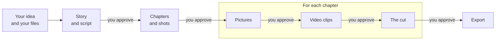
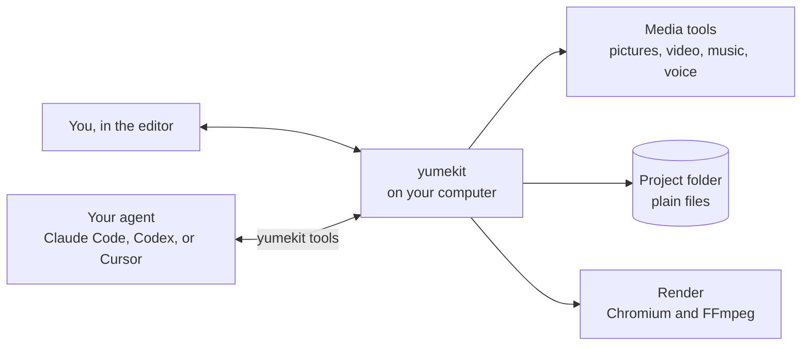

# yumekit

The open source video harness for AI agents.

**Directed, not just generated.** Reels, explainers, trailers, and films, with one story, one cast, and one look in every shot.

TRAILER_VIDEO_URL

_Unwritten_ started as a rough story. The lead agent wrote the whole story and the script, designed the cast, planned the shots, and cut the trailer. A person approved each step.

## What the trailer cost

| Part                                                              | Made with                             | Made     | In the trailer | Cost                   |
| ----------------------------------------------------------------- | ------------------------------------- | -------- | -------------- | ---------------------- |
| Story, script, shot plan, and edit                                | Claude Code as the lead agent         |          |                | Part of a Claude plan  |
| Pictures: character sheets, costumes, places, props, first frames | Codex, signed in with ChatGPT         | 69       |                | Part of a ChatGPT plan |
| Video clips of 3 and 4 seconds at 720p                            | Gemini Omni 1.2 Flash, $0.07 a second | 21 clips | 13 clips       | $4.59                  |
| Music                                                             | Lyria 3.5, $0.08 a track              | 3 tracks | 1 track        | $0.24                  |
| Title cards, edit, and render                                     | yumekit, on your computer             |          |                | $0                     |
| **Total**                                                         |                                       |          |                | **$4.83**              |

The clips and the music in the final cut cost $2.93. The other $1.90 went on retakes and on two music tracks that were not picked. The costs are the list prices of the models.

## How it works



1. **You give the idea.** Pick a trailer, a movie, or a video, and tell the lead agent as much as you can. Drop in pictures or character sheets that you already have.
2. **The lead writes the story.** It asks you questions first. Then it writes the whole story and the script.
3. **The lead plans the work.** A long film gets chapters. Each chapter gets its shots.
4. **The lead makes each step as a take.** Character sheets, costumes, places, and the first picture of each shot come first. Video clips come only from pictures that you approved.
5. **You review each take.** Approve or decline each item, pin a comment on a picture, or mark a moment in a clip. Your notes make the next take.
6. **The lead cuts the film.** It puts the clips, the music, and the title cards together. You approve the cut, then go to the next chapter or export.

## What it does

**Make**

- **Story first.** The lead writes the whole story and the script before the first shot.
- **One design for each character.** Character sheets and costumes for each scene. yumekit checks each picture and clip against them.
- **Real video clips.** From a first picture, and a last picture if you want, with a camera move.
- **Scenes drawn by code.** 26 scene types and 5 looks, with motion and transitions. The text is exact, and a change costs nothing.
- **Music and a voice.** From a model with a key, or made on your computer for free.

**Review and change**

- **Takes.** Every picture, clip, and music track comes to you as a take. Mark what is wrong, and the rest is approved.
- **An editor.** Change a text with a click, drag scenes and chapters, and undo each change.
- **Your own files.** Bring a picture, a sound, or a video, and keep each file that yumekit makes.

**Publish**

- **One video for each platform.** YouTube, YouTube Shorts, TikTok, Instagram Reel, Instagram post, X, LinkedIn, and square, each in its own shape.

**Own it**

- **Everything stays on your computer.** A project is a folder of plain files. yumekit has no server and no account.
- **Open source.** Apache License 2.0.

## Use what you already have

You choose the tool for each job, in Settings.

| Job                                                | Your choices                                                                                                                               |
| -------------------------------------------------- | ------------------------------------------------------------------------------------------------------------------------------------------ |
| The lead agent, and the agent that checks its work | Claude Code, Codex, or Cursor, on the plan that you already pay for. You also choose the model, and the effort for Claude Code and Codex.  |
| Pictures                                           | Codex signed in with ChatGPT, with no API key. Or an API key for OpenAI GPT Image, Google Nano Banana and the Gemini image models, or fal. |
| Video clips                                        | Google Gemini Omni Flash, or fal models such as Kling, Wan, PixVerse, LTX, and MiniMax.                                                    |
| Music                                              | Your own royalty-free track, music that yumekit composes on your computer with no key, or Google Lyria.                                    |
| Voice                                              | A voice that runs on your computer with no key, or the OpenAI and Gemini voices.                                                           |
| Anything else                                      | Any media tool that is an MCP server, also one that runs a model on your computer.                                                         |

## Get started

You need Node.js 22 or later, and FFmpeg. If FFmpeg is missing, `yumekit doctor` gives the command that installs it on your system.

```sh
npm install -g yumekit
yumekit setup
yumekit
```

1. `npm install -g yumekit` installs yumekit.
2. `yumekit setup` downloads the browser that draws your videos. It runs one time.
3. `yumekit` opens the start screen in your browser. Pick what you want to make, describe it, and start.

One agent program (Claude Code, Codex, or Cursor) must be installed and signed in. Your projects are folders in `~/Documents/yumekit`.

If something does not work, run `yumekit doctor`. It checks Node.js, FFmpeg, the browser, and the agent programs. Each line that is not "ok" says what to do.

## Or let your agent do it

Paste this into Claude Code, Codex, Cursor, or another coding agent:

```text
Read https://github.com/theonly1me/yumekit/blob/main/skills/yumekit/SKILL.md and set up yumekit on this computer. Then start it for me.
```

The file tells the agent how to install yumekit, how to check the computer, and how to make a video with the yumekit tools. In a clone of this repository, the same file is `skills/yumekit/SKILL.md`.

## Keys

- **The agent needs no key.** yumekit uses the sign-in of your agent program.
- **A voice and music from your computer need no key.** The voice downloads once (148 MB).
- **Pictures need no key with Codex.** Each picture uses your ChatGPT plan.
- **Every other service needs its own key.** Add it in Settings, or run `yumekit keys set <VARIABLE>`.
- **Your keys stay on your computer.** yumekit sends each key only to its own service.
- **New models are marked.** A model that nobody has run with yumekit yet shows "Not tested with yumekit yet".

## Use an agent from the terminal

Connect Claude Code, Codex, or Cursor to a project:

```sh
yumekit agent connect --agent claude-code --project my-video
```

Any other MCP client can start the yumekit MCP server with `npx`:

```sh
npx -y yumekit mcp --project /path/to/my-video
```

## Under the hood



- **The agent is the brain.** Any MCP client works.
- **Each media tool is an MCP server.** Add your own next to the built-in ones.
- **A project is a folder of plain files.** It works with git.
- **The render is our own open stack.** Headless Chromium and FFmpeg draw each frame, so each frame stays editable.
- **One way to change a project.** The agent and the person use the same edit operations.

## Design and code

The design is in `docs/design`: read `docs/design/README.md` first. To build yumekit from its source and to change it, read `CONTRIBUTING.md`.

## License

yumekit uses the Apache License 2.0. See `LICENSE`.
