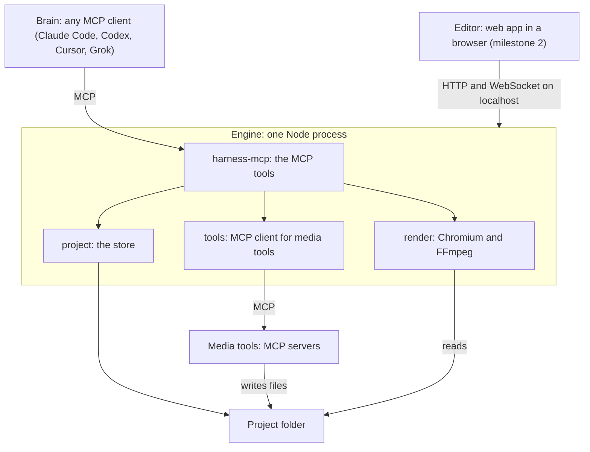

# 01 Architecture

## Processes



With no editor, the engine is the process that `yumekit mcp` starts, and it serves one MCP client over stdio. `yumekit open` starts the engine with the editor server. One engine owns one project folder, and `yumekit mcp` then connects to it (document 11).

## Packages

| Package                | Runs in | Owns                                                                          | Public interface                                                                                                                                    |
| ---------------------- | ------- | ----------------------------------------------------------------------------- | --------------------------------------------------------------------------------------------------------------------------------------------------- |
| `@yumekit/scene`       | Browser | The scene contract, the React adapter, the animation functions                | `SceneModule`, `defineReactScene`, `useFrame`, `useSceneContext`, `useHold`, `FrameWindow`, `tween`, `spring`, `stagger`, `easings`, `seededRandom` |
| `@yumekit/scene-kit`   | Browser | Ready scene components and style packs                                        | `kitScenes` for the browser, and `kitSceneSchemas` from the entry `@yumekit/scene-kit/schemas`, which has no browser code                           |
| `@yumekit/project`     | Node    | The folder format, schemas, validation, edit commands, undo, change events    | `createProject`, `openProject`, the `ProjectStore` it returns, and `scenesRowOf`                                                                    |
| `@yumekit/stage`       | Browser | Drawing one output at one frame from project data and scene modules           | `createStage`                                                                                                                                       |
| `@yumekit/render`      | Node    | Frames and video files. Hides Chromium, the bundler, and FFmpeg               | `renderFrame`, `renderSceneFrame`, `renderVideo`, `checkSceneCode`                                                                                  |
| `@yumekit/tools`       | Node    | Connections to media MCP servers and the media tool convention                | `connectMediaTools`                                                                                                                                 |
| `@yumekit/harness-mcp` | Node    | The MCP tools that map to edits, media jobs, and renders                      | `createHarnessServer`                                                                                                                               |
| `@yumekit/brain`       | Node    | The adapters that run the agent program of the person (document 12)           | `createClaudeCodeAdapter`, `createCodexAdapter`, `brainInstructions`, `personSentenceOf`                                                            |
| `@yumekit/engine`      | Node    | The editor server: HTTP, events, and one engine for one project (document 11) | `startEngine`, `findRunningEngine`, `startHomeServer`, `recordRecentProject`                                                                        |
| `apps/cli`             | Node    | The `yumekit` command                                                         | `yumekit`, `yumekit init`, `yumekit mcp`, `yumekit render`, `yumekit frame`, `yumekit keys`, `yumekit open`                                         |
| `apps/editor`          | Browser | The web editor (document 11)                                                  | A built web app that the engine serves                                                                                                              |
| `tools/*`              | Node    | Bundled media tool servers, one folder for each                               | One MCP server each                                                                                                                                 |

## Dependency rules

A package may import only the packages in its row. CI must fail on any other import between packages.

| Package       | May import                                                                                        |
| ------------- | ------------------------------------------------------------------------------------------------- |
| `scene`       | nothing from yumekit                                                                              |
| `scene-kit`   | `scene`                                                                                           |
| `project`     | nothing from yumekit                                                                              |
| `stage`       | `scene`, and types only from `project`                                                            |
| `render`      | `project`, `stage`, `scene-kit`                                                                   |
| `tools`       | nothing from yumekit                                                                              |
| `harness-mcp` | `project`, `render`, `tools`, and `scene-kit/schemas`                                             |
| `brain`       | nothing from yumekit                                                                              |
| `engine`      | `project`, `render`, `tools`, `harness-mcp`, `brain`, and `scene-kit/schemas`                     |
| `apps/cli`    | `project`, `render`, `tools`, `harness-mcp`, `engine`                                             |
| `apps/editor` | only `project/scenes-row`, `project/platforms`, `project/asset-uses`, and `scene-kit` at run time |
| `tools/*`     | nothing from yumekit                                                                              |

Two more rules:

1. A package imports another package only through its package name. It never imports a file path inside the other package.
2. Browser packages (`scene`, `scene-kit`, `stage`) never import a Node module.

## Errors

An expected failure is a return value with a `kind` field. Examples are a missing file, an invalid edit, and a tool that fails.

```ts
type Outcome<Value, Failure> =
  { ok: true; value: Value } | { ok: false; failure: Failure };
```

Each package defines its own failure union and its own `Outcome` alias. A thrown `Error` means a defect in yumekit. Code that calls a library that throws catches the error at that call and converts it.

## Identifiers

Each id is a string that the caller can supply. If the caller gives no id, the store makes one with `crypto.randomUUID()`. An id matches `^[a-z0-9][a-z0-9-]{0,63}$`. An agent should supply readable ids, such as `intro` or `chart-revenue`.

## Technology choices

| Need                              | Choice                                                       | Reason                                                         |
| --------------------------------- | ------------------------------------------------------------ | -------------------------------------------------------------- |
| Schemas and validation            | `zod`                                                        | One definition gives the type and the runtime check            |
| Scene bundling and the stage page | `vite`                                                       | It serves TSX to Chromium now and to the editor later          |
| Headless browser                  | `playwright-core` with Chromium                              | One driver for the renderer and for browser tests              |
| Video and audio encoding          | `ffmpeg` and `ffprobe` from the `PATH`                       | Standard, free, and already on most creator machines           |
| MCP server and client             | `@modelcontextprotocol/sdk`                                  | The reference SDK. Use the 1.x line, which npm marks as latest |
| Tests                             | `vitest`. Browser tests use its browser mode with Playwright | Already in the repository                                      |

The builder of each work package reads the current documents of a library before use. Versions come from the registry, never from memory.

## What the core must never depend on

- `gsap`, or any package that requires it.
- Any HyperFrames or Remotion package.
- A package with a license that is not MIT, BSD, ISC, Apache-2.0, or MPL-2.0. A font may use the SIL Open Font License. Ask the owner about any other license.
